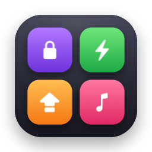
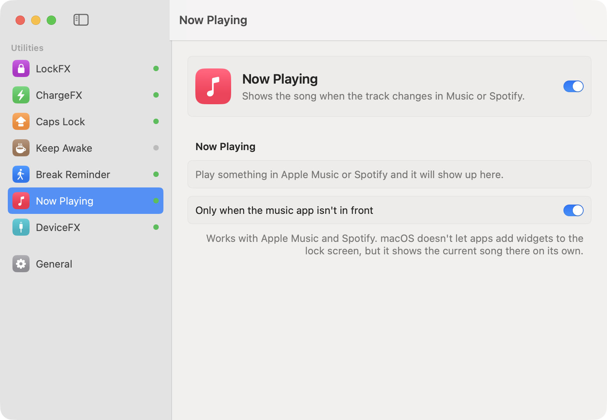

<p align="center">
  
</p>

<h1 align="center">MacFX</h1>

<p align="center">
  A collection of small, delightful utilities for your Mac, in one native app.<br>
  Built with SwiftUI and AppKit. No dependencies, no permissions prompts, no tracking.
</p>

<p align="center">
  
</p>

## Utilities

| | Utility | What it does |
|---|---|---|
| 🔒 | **LockFX** | Plays a sound when your Mac locks and unlocks. |
| ⚡️ | **ChargeFX** | Chimes when the charger connects or disconnects, plus low-battery and charge-limit alerts. |
| ⇪ | **Caps Lock** | Shows an on-screen badge and clicks when Caps Lock turns on or off. |
| ☕️ | **Keep Awake** | Keeps your Mac (and optionally the display) awake for 15 minutes to indefinitely. |
| 🚶 | **Break Reminder** | Nudges you to rest your eyes after 20–90 minutes of continuous use. Locking your Mac or stepping away resets the timer. |
| 🎵 | **Now Playing** | Shows the song and artist when the track changes in Apple Music or Spotify. |
| 🔌 | **DeviceFX** | Sounds and badges when USB devices and external drives connect or disconnect. |

Every utility can be turned on or off on its own, and every sound can be swapped for your own audio file.

## Install

1. Download `MacFX.zip` from the [latest release](../../releases/latest) and unzip it.
2. Move **MacFX.app** to your Applications folder.
3. The app isn't notarized, so the first time, right-click it and choose **Open**. You can also go to **System Settings → Privacy & Security** and click **Open Anyway**.

MacFX opens at login and keeps running in the background. Close the window whenever you like, and open MacFX again from Spotlight to get back to settings. There's also an optional menu bar icon for quick toggles.

Requires macOS 14 Sonoma or later.

## Build from source

You only need the Xcode Command Line Tools (`xcode-select --install`).

```bash
git clone https://github.com/HarshaXR/MacFX.git
cd MacFX
scripts/build.sh            # builds build/MacFX.app and dist/MacFX.zip
scripts/build.sh --install  # also copies it to /Applications and launches it
```

## How it works

MacFX avoids private APIs and permission prompts by listening to signals macOS already broadcasts:

| Utility | Signal |
|---|---|
| LockFX | `com.apple.screenIsLocked` / `screenIsUnlocked` distributed notifications |
| ChargeFX | IOKit power source notifications (`IOPSNotificationCreateRunLoopSource`) |
| Caps Lock | Polls `CGEventSource.flagsState` every 100 ms, so no Input Monitoring permission is needed |
| Keep Awake | IOKit power assertions (`IOPMAssertionCreateWithName`) |
| Break Reminder | System idle time (`CGEventSource.secondsSinceLastEventType`) plus lock and wake events |
| Now Playing | Distributed notifications posted by Apple Music and Spotify |
| DeviceFX | IOKit USB matching notifications and `NSWorkspace` mount events |

The built-in sounds are synthesized in code ([`Sound.swift`](Sources/MacFX/Sound.swift)), and the app icon is drawn in code too ([`make_icon.swift`](scripts/make_icon.swift)). So the repo contains no binary assets, and everything can be tweaked.

```
Sources/MacFX/
├── MacFXApp.swift       App entry, window/Dock behavior, login item
├── Sound.swift          Synthesized sounds + custom sound support
├── HUD.swift            System-style on-screen badge
├── Modules/             One file per utility
└── Views/               SwiftUI settings window and menu bar menu
```

## License

[MIT](LICENSE)
